# DiexvILauncher 1.4

English | [简体中文](README.md)

DiexvILauncher is an independent third-party launcher for **Minecraft: Java Edition**, written in **WPF / .NET 8** for Windows 10/11 x64. It covers installing and launching game versions, mod and modpack management, resource packs / shaders / worlds / servers, skin preview, and Microsoft account sign-in.

**Download**: [latest release](https://github.com/1397559266/DiexvILauncher/releases/latest) — a self-contained Windows x64 zip; unzip and run `DiexvILauncher.exe`, no .NET runtime installation required.

- **Accounts**: Microsoft sign-in (OAuth 2.0 authorization code + PKCE in the system browser; the launcher never sees your password), or an offline account limited to single-player and offline-mode servers.
- **Game files**: everything is downloaded from Mojang's own servers or the BMCLAPI mirror. This repository contains and distributes no Minecraft game files or official textures.
- **Data**: there is no backend service. Access and refresh tokens are stored locally, encrypted with Windows DPAPI — see [PRIVACY.md](PRIVACY.md).
- **License**: see [LICENSE](LICENSE). The source is published for reading and review; the released binaries may be downloaded, installed and run freely.

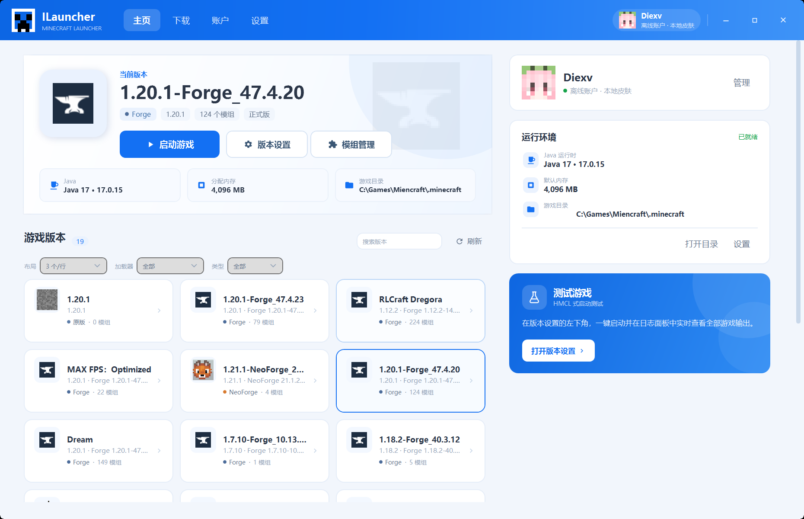

## Features

| Area | What it does |
| --- | --- |
| Skins | Nine Mojang default skins extracted from the local client jar, 64×64 skin import, multi-layer rendering (hat/jacket/sleeves/pants), Steve/Alex model switch, pixelated 3D rotate/zoom preview, cape display, skin library, avatar sync to the title bar and home page |
| Microsoft sign-in | OAuth 2.0 authorization code + PKCE, then Xbox Live → XSTS → Minecraft Services, with a `entitlements/mcstore` ownership check; device-code flow kept as a fallback |
| Profile lookup | Look up any player by name or UUID through Mojang's public profile API and add the skin/cape to the local library |
| Icons | Per-version PNG icons, modpack icons, Fabric/Quilt/Forge/NeoForge/OptiFine loader badges, icons read from inside mod jars, `pack.png` for resource packs, `icon.png` for worlds, server icons |
| Downloads | Mojang version manifest (type filter + version search), vanilla install, Fabric/Quilt, Forge/NeoForge installers, `.mrpack` import |
| Modrinth | Search and install mods, resource packs and shaders; filters for game version, loader and category; update checks with one-click update |
| Resource management | Import/delete/open resource packs and shaders; browse, back up and delete worlds; screenshots; server list read/write with one-click join |
| Tools | Export a launch script (`.bat`), export an instance as zip, crash log analysis, Java runtime download (Adoptium 8/17/21) |
| Launching | Offline account (single-player / offline servers only, with a one-time notice), automatic Java selection, memory and window overrides, per-instance isolation, live log panel, process-tree stop |

### Skins and avatars

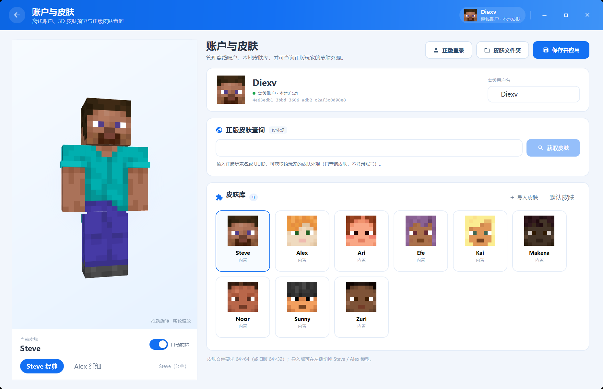

- **3D preview**: the blocky Minecraft body is assembled directly with WPF `Viewport3D`; drag to rotate, scroll to zoom, optional auto-rotation.
- **Multi-layer skins**: hat, jacket, both sleeves and both pant legs of 64×64 skins are rendered as separate layers with alpha blending and a slight outward offset to avoid z-fighting. Legacy 64×32 skins show the base layer only.
- **Avatar sync**: the title bar, the home page account card and the skin library all use the head of the current skin, including the hat layer.
- **Skin library**: at startup the launcher scans `.minecraft/versions/*/*.jar` and extracts the Mojang default skins (Steve, Alex, Ari, Efe, Kai, Makena, Noor, Sunny, Zuri) from the client assets. No Mojang texture is bundled in this repository; when no client is available a neutral placeholder is generated.
- **Microsoft sign-in**: the Account page uses OAuth 2.0 authorization code + PKCE through the system browser, so an already signed-in Microsoft account usually only needs one click on "Continue". Release builds ship an Application (client) ID registered for the Minecraft API review, so players do not need their own Azure app. After sign-in the launcher walks Xbox Live → XSTS → Minecraft Services, verifies ownership through `entitlements/mcstore`, and stores tokens with Windows DPAPI, refreshing them automatically before launch.
- **Profile lookup**: enter a player name or UUID to download that profile's skin/cape from Mojang's public API. No credentials are stored.
- Skin files live in `%APPDATA%\ILauncher\skins\` (64×64 and legacy 64×32).

#### Custom client ID (developers)

Release builds ship an Application (client) ID registered for the Minecraft API review; regular players do not need to configure anything. For development builds the value can be overridden:

```powershell
$env:MS_CLIENT_ID = "your Azure Application (client) ID"
.\DiexvILauncher.exe
```

`ILAUNCHER_MS_CLIENT_ID` works as well. The ID must belong to an Azure app you registered yourself — do not borrow another launcher's ID. Changing the bundled ID requires a new Minecraft API AppID review. The full walkthrough (app registration, redirect URIs, review submission) is in [docs/azure-app-setup.md](docs/azure-app-setup.md).

> **A new Azure app must pass the Minecraft Services app registration review first.** Until then OAuth, Xbox Live and XSTS all succeed, but `login_with_xbox` returns `HTTP 403 Invalid app registration`. This is an allow-list restriction, unrelated to "allow public client flows", and it cannot be worked around by using somebody else's client ID.

### Version icons

- A PNG can be selected in the version overview ("quick actions → change local icon") and is stored as `versions/<version>/icon.png`, matching the convention used by mainstream launchers; "restore default icon" deletes it.
- Importing a `.mrpack` reads `icon.png`/`pack.png` from the archive root and from `overrides/` and `client-overrides/`, and copies it as the version icon.
- The home version list can be filtered by loader (vanilla/Forge/Fabric/NeoForge/Quilt/OptiFine), by release type (release/snapshot/old) and by name; the count shows "filtered / total".
- The layout can be switched manually between a list and 2/3/4 items per row; the choice is persisted.
- Version icons on the download page use official textures extracted from the local client jar (grass block for releases, command block for snapshots, potato for April Fools' builds); textures are extracted to `%APPDATA%\ILauncher\textures` and are not bundled.
- Loader badges (Fabric/Quilt/Forge/NeoForge/OptiFine) are used when no local icon is set; attribution is in `Assets/Loaders/README.md`.
- Mod icons are read from jar metadata, resource packs use `pack.png`, worlds use `icon.png`.

### Top navigation

- The top bar always exposes **Home / Downloads / Account / Settings**; sub-pages do not hide it.
- The download page switches between **game versions / mods / resource packs / shaders** with four large buttons.
- Version pages keep their own left navigation (overview, settings, mods, resource packs, shaders, worlds, screenshots, servers).
- The standalone "test game" button stays at the bottom left of that sidebar.

### Downloads

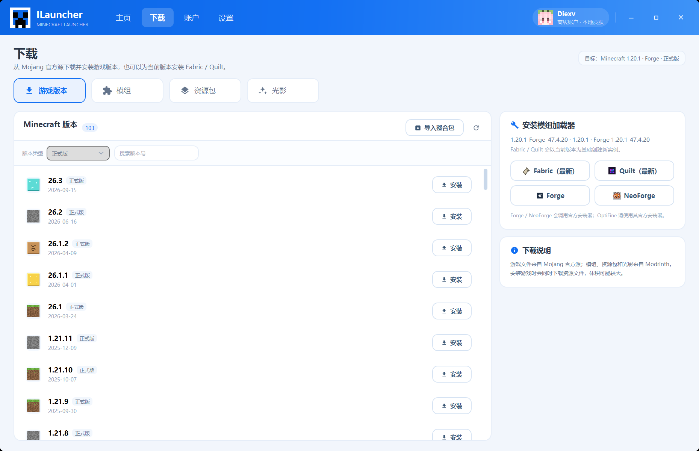

- **Game versions**: the Mojang version list defaults to releases, can be filtered by release type and searched by version string. Pick a version, choose a loader and loader version on the right, then install.
- **Loaders**: vanilla / Fabric / Quilt / Forge / NeoForge, with the versions available for the selected game version. Fabric and Quilt use the Meta API; Forge and NeoForge run their official installer jar and create a minimal `launcher_profiles.json` when it is missing.
- **Modpacks**: Modrinth `.mrpack` import resolves the Minecraft and loader versions from the pack, installs them, downloads the files and copies `overrides`.
- **Modrinth content**: mods, resource packs and shaders with filters (game version range, loader, category; resolution for packs, style for shaders), 20 results per page and pagination. Results also carry Chinese names from MC百科 and a CurseForge search link.
- **MC百科**: Chinese names and entry links are matched through the public search page and cached locally.
- **CurseForge**: search and download through the MCIM mirror (`mod.mcimirror.top`), **no CurseForge API key required**. Results are merged with Modrinth and de-duplicated by slug: a mod present on both sites appears once, tagged `Modrinth + CurseForge`, `CurseForge` or `Modrinth`. The install dialog lists files from both sources with a source tag, preselects the newest file, and lets you choose the other source manually. The search bar also has a **download platform** switch: **Auto (both) / Modrinth only / CurseForge only**, and switching re-runs the search immediately.
- **Progress**: the download panel shows phase, file name and percentage, and can be cancelled.

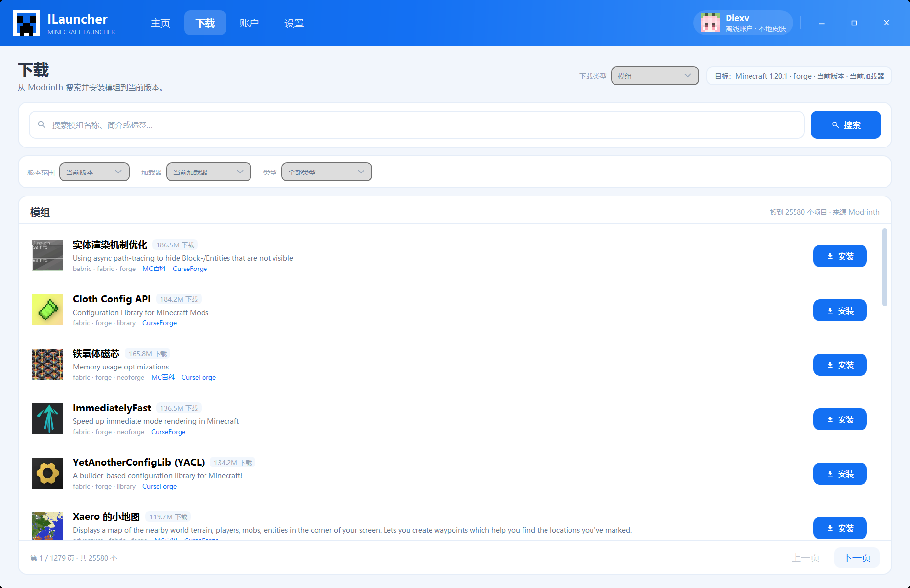

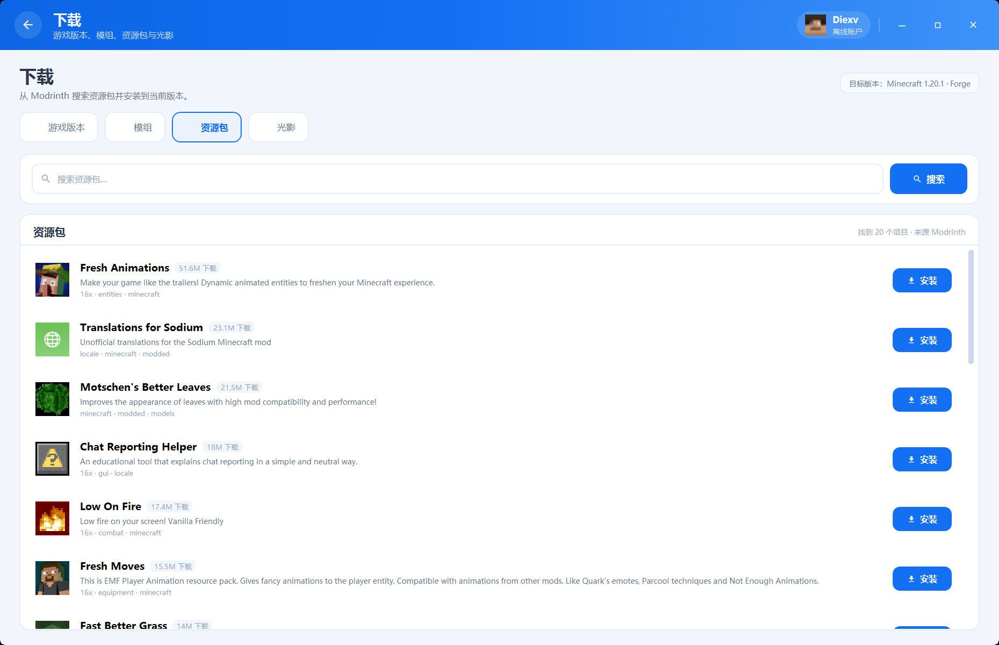

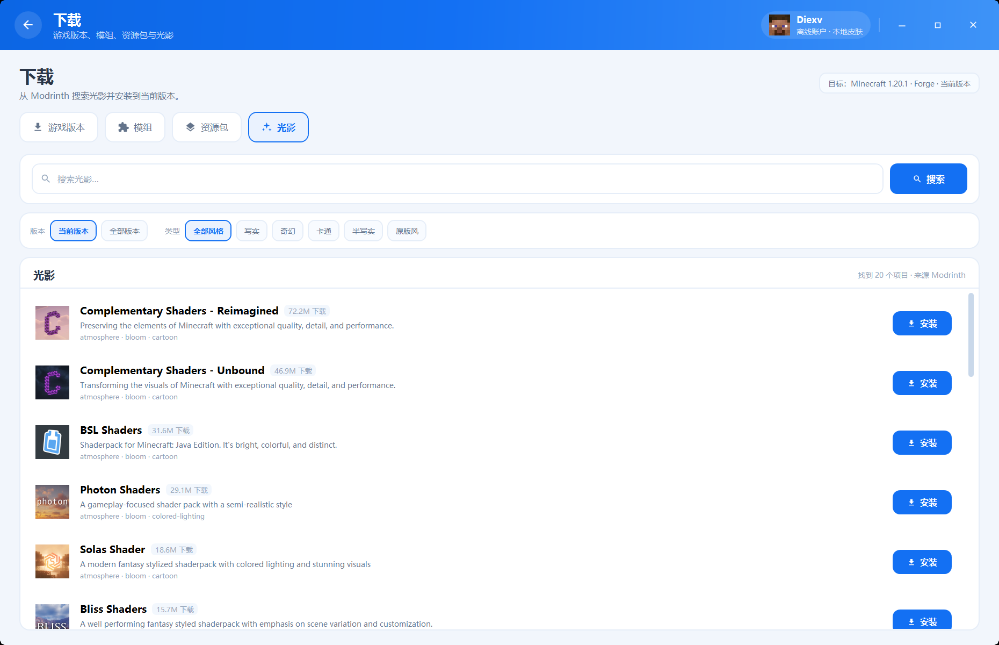

### Resource management

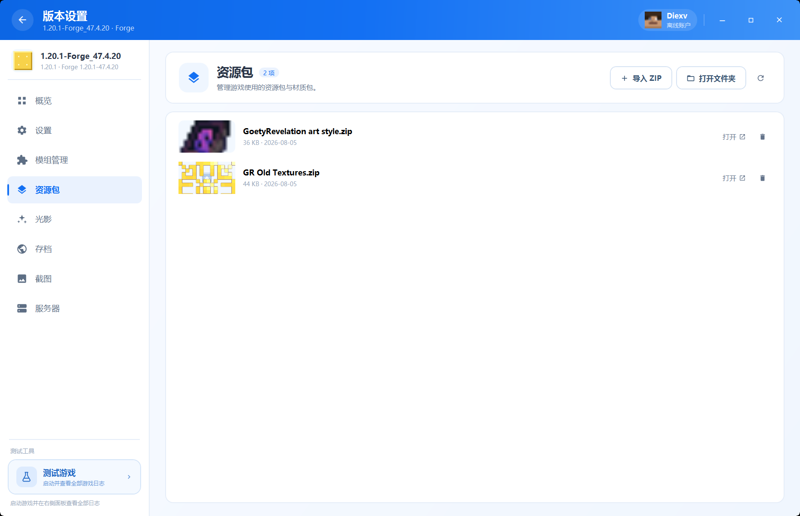

- Resource packs and shaders: import a zip, open or delete the folder, `pack.png` is used as the icon.
- Worlds: shows `icon.png`, backs up to zip under `%APPDATA%\ILauncher\backups\saves`, deletes.
- Screenshots: real thumbnails, open in the default viewer or delete.
- Servers: reads and writes `servers.dat` (NBT), shows name/IP/icon, supports add/edit/delete, and "join" launches the game with `--server`/`--port`.

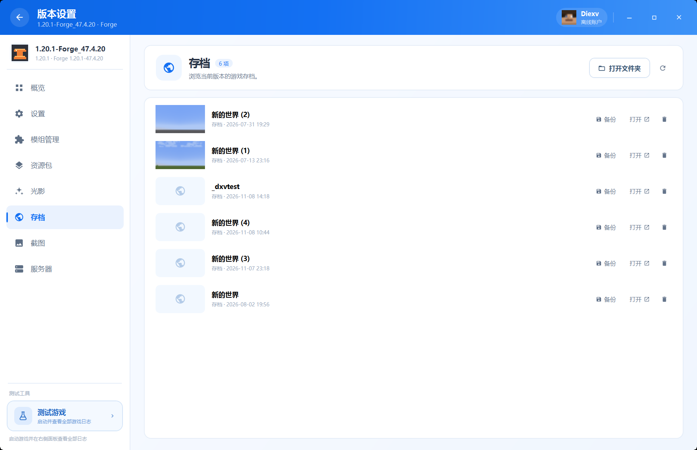

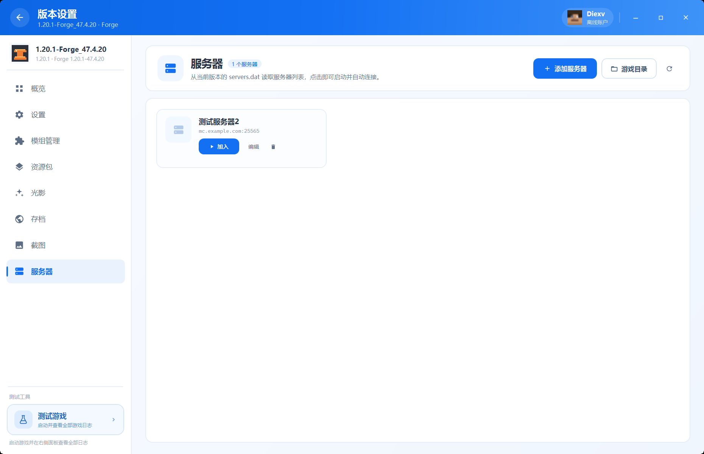

### Mods

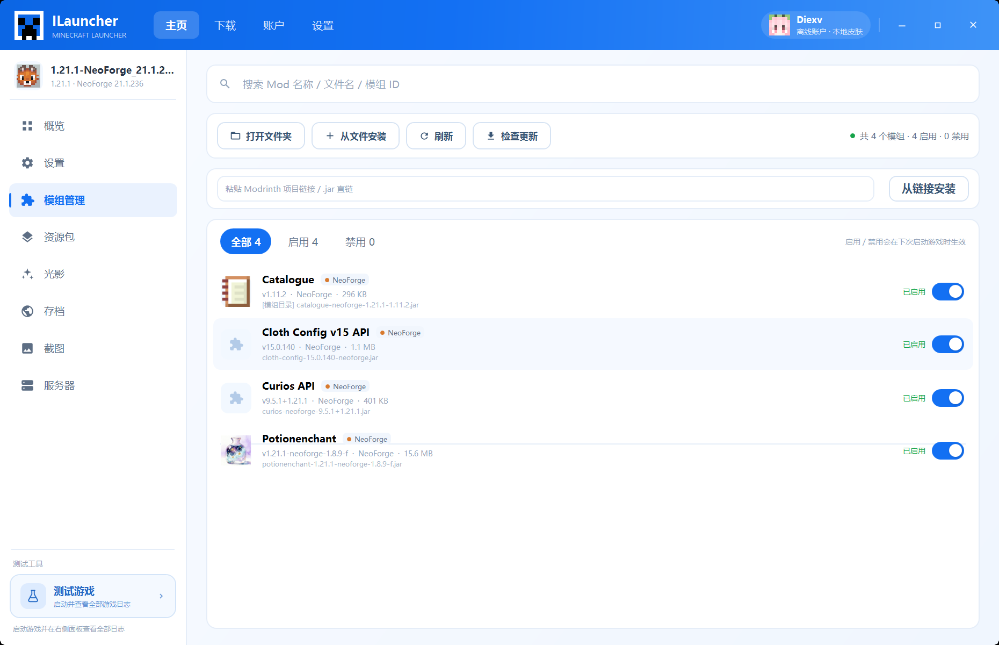

- Reads `mods/*.jar` and `*.jar.disabled`; enable/disable by renaming, effective on the next launch.
- Display name, version, mod id and icon are read from `fabric.mod.json`, `quilt.mod.json`, `META-INF/mods.toml` and `MANIFEST.MF`.
- Search, filter (all/enabled/disabled), install from file, install from link, open folder, refresh.
- The install dialog offers the target game version, loader and release channel, then the concrete file version; declared prerequisites (required/optional) are listed recursively, with a one-click install for missing required ones.
- Chinese mod names are resolved to their English aliases through MC百科 before searching Modrinth.
- Dependency scanning reads both Modrinth metadata and jar metadata, using HTTP range requests so that jars are not downloaded in full; results are cached in `jar-dependencies.json`.
- Install from link resolves Modrinth project URLs (and direct `.jar` links). Update checks resolve the project through Modrinth's SHA-1 file lookup.

### Standalone "test game" button

Fixed at the bottom left of the version sidebar, in a "test tools" area below the navigation list. It is not part of the navigation and does not change the top bar. Clicking it:

1. switches the right-hand pane to "test game · launch log";
2. launches the Java process with the current version configuration;
3. streams launch stages, the game's stdout/stderr, the exit code and the log file path;
4. supports level filtering, search, auto-scroll, copy, open log file/folder, stop and re-test;
5. runs a basic crash analysis after a failed start and writes the suggestions into the log.

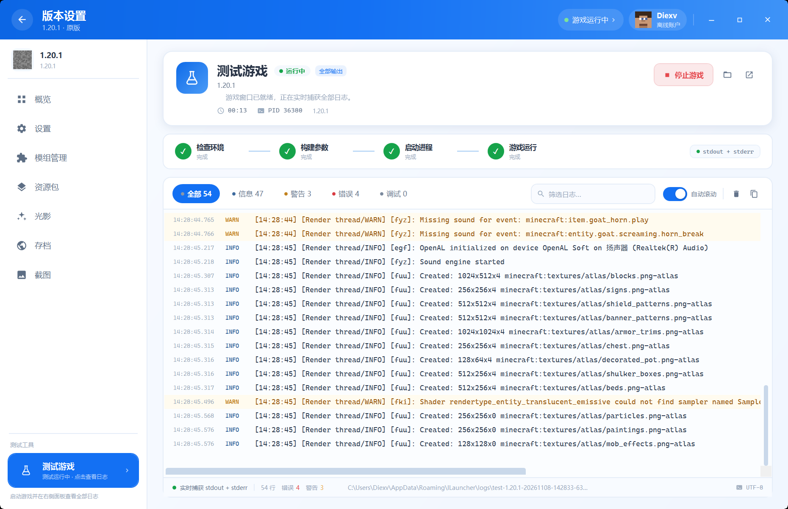

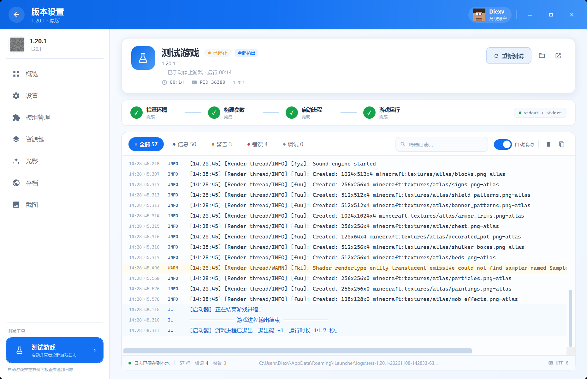

### Version overview and tools

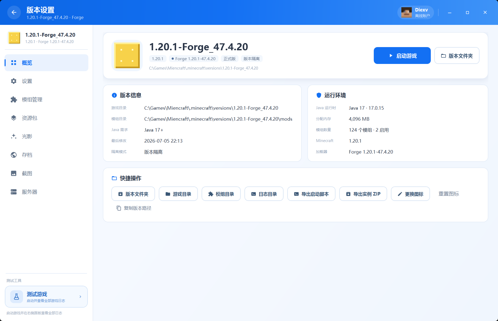

- Version information, Java and memory settings, paths, isolation mode.
- Open the version, game, mods or logs folder.
- Export a launch script with the real resolved Java path, classpath and JVM/game arguments.
- Export the instance as a zip, excluding logs, crash reports, screenshots, natives and caches.
- Change or reset the version icon.

### Launcher settings

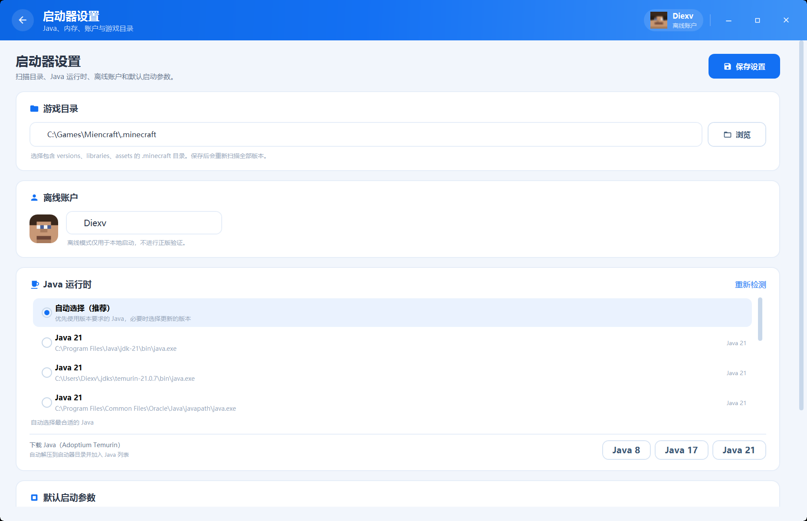

- Minecraft directory, offline user name, Java selection, download source, default memory, game window size, minimize after launch.
- Java runtime list, re-detection, Adoptium Java 8/17/21 downloads.
- Game file download source: official first or BMCLAPI mirror first, falling back to the official source.
- Settings are stored in `%APPDATA%\ILauncher\settings.json`.

## Design notes

- **Layering**: `ILauncher.Core` handles version resolution, launching, downloads, Java, mods and profile lookup; `ILauncher` is the WPF/MVVM UI layer. The two communicate through explicit models and service boundaries.
- **UI**: a custom chrome window with hand-built controls (`Controls/`); themes and icons live in `Themes/`. No code, icon or art asset from another launcher is used.
- **Sign-in chain**: Microsoft OAuth (authorization code + PKCE) → Xbox Live → XSTS → Minecraft Services → `entitlements/mcstore` check → Java process. Tokens are stored with DPAPI.
- **Offline mode**: never impersonates a licensed session; it is intended for single-player and offline-mode servers, and the boundary is shown once before the first offline launch.

## Build / run

Requirements: Windows 10/11 x64, [.NET 8 SDK](https://dotnet.microsoft.com/), and a matching Java runtime (needed to run the game).

Debug build:

```powershell
dotnet build ILauncher.sln -c Release
```

Self-contained single-file build (identical to the release package, no .NET runtime needed on the target machine):

```powershell
dotnet publish src/ILauncher/ILauncher.csproj -c Release -r win-x64 `
  --self-contained true `
  -p:PublishSingleFile=true `
  -p:IncludeNativeLibrariesForSelfExtract=true `
  -p:EnableCompressionInSingleFile=true `
  -o dist/DiexvILauncher
```

Run:

```powershell
.\dist\DiexvILauncher\DiexvILauncher.exe
```

Alternatively `dotnet run --project src/ILauncher/ILauncher.csproj`.

## Usage

1. On first start the launcher looks for `%APPDATA%\.minecraft`, `C:\Games\Minecraft\.minecraft` and similar paths; the directory can also be picked in the settings.
2. Select a version on the home page and press "launch", or open the version page.
3. The "test game" button at the bottom left opens the launch log panel.
4. The download page installs versions, loaders, mods, resource packs and shaders, or imports `.mrpack` modpacks.
5. The account page imports skins, switches between Steve/Alex and looks up official skins; the title bar and home page avatars follow.
6. The mods page checks for updates, enables/disables, searches and installs.

### Data locations

| Content | Path |
| --- | --- |
| Settings | `%APPDATA%\ILauncher\settings.json` |
| Launch logs | `%APPDATA%\ILauncher\logs\` |
| Skin library | `%APPDATA%\ILauncher\skins\` |
| Version icons | `versions\<version>\icon.png` (legacy `%APPDATA%\ILauncher\icons\` is still read) |
| Version list textures | `%APPDATA%\ILauncher\textures\` (extracted from the local client jar) |
| Native cache | `%APPDATA%\ILauncher\cache\natives\` |
| MC百科 cache | `%APPDATA%\ILauncher\mcmod-cache-v2.json` |
| Downloaded Java | `%APPDATA%\ILauncher\java\` |
| World backups | `%APPDATA%\ILauncher\backups\saves\` |

## Project structure

```
ILauncher.sln
src/ILauncher.Core/          launch engine, version resolution, Java, mods, downloads, logs, profile lookup
src/ILauncher/               WPF UI (MVVM)
  Themes/                    colors, icons, control styles
  Views/                     home, account/skins, downloads, version page, mods, logs, settings
  ViewModels/                navigation, skins, downloads, mods, logs, servers, settings
  Controls/                  Icon, SkinHead, SkinPreview, 3D skin model
  Assets/                    pixel blocks, original skins, app icon
tools/Probe/                 console launch probe
tools/                       helper scripts for screenshots and asset generation
docs/screenshots/            README screenshots
```

## Verified

- Forge 1.20.1 with 124 mods (2 enabled): real launch, log panel captured 7,000+ lines, window detection, process-tree stop.
- Vanilla 1.20.1: launch, stop, log panel.
- Fabric install through the Meta API (`fabric-loader-0.20.1-1.20.1`, cleaned up after testing).
- Modrinth: search, filters, pagination, Chinese names, installing a resource pack into a version directory.
- Vanilla 1.20.1 installer: version JSON, client jar and 65 libraries downloaded into a temporary directory.
- Forge official installer: complete `1.20.1-forge-47.4.21` install in a fresh temporary directory, including `launcher_profiles.json` generation and patching.
- Mod update detection and one-click update (old file disabled, new file enabled).
- Skins: nine Mojang default skins extracted at runtime, Steve/Alex slim/wide mapping, multi-layer 64×64 rendering, pixelated 3D preview, official profile lookup, avatar sync.
- Servers: `servers.dat` NBT round-trip, add/edit/delete in the UI.
- Resource packs, worlds, screenshots, instance export and launch script export exercised against real files.
- Crash analysis rules (OutOfMemory, too old Java, Mixin failures) triggered on purpose.
- Java: Adoptium API parsing and byte-level download progress.
- Microsoft sign-in: browser authorization code + PKCE, loopback callback, `prompt=none` preflight, state validation, token exchange and `entitlements/mcstore` parsing are covered by automated tests; a complete sign-in is still gated by the Minecraft Services allow-list (see the 403 note above).
- The release build was started and verified.

## Accounts and ownership check

| Account type | Can do | Cannot do |
| --- | --- | --- |
| Microsoft sign-in | Single-player, online-mode servers, Realms, skin and cape sync | — |
| Offline account | Single-player, offline-mode servers | Online-mode servers (connection refused), Realms |

- After a successful Microsoft sign-in the launcher calls `GET /entitlements/mcstore` to confirm the account actually owns Minecraft: Java Edition. Without ownership the sign-in fails with an explicit message instead of launching with an invalid token.
- Offline accounts never impersonate a licensed session. A one-time notice explains the boundary before the first offline launch; the flag can be reset through `OfflineLaunchAcknowledged` in `settings.json`.
- The Microsoft token is refreshed before every launch; if the refresh fails the launcher falls back to the stored token and says why in the log.

## Known limitations

- **Microsoft sign-in depends on the client ID passing the Minecraft Services review**: until then `login_with_xbox` returns 403. Tokens are encrypted with Windows DPAPI and refreshed automatically.
- **Offline accounts cannot join online-mode servers** — that is a designed boundary, stated in the one-time notice.
- OptiFine and LiteLoader are not installed automatically; their own installers are still required.
- CurseForge modpacks and resource packs are not integrated; mod search and downloads work through the MCIM mirror; modpacks remain Modrinth `.mrpack` only.
- No resource pack ordering editor, no online world/datapack download.
- Installing a mod does not automatically resolve and install its dependencies; only the main file is installed.
- Forge/NeoForge use their official installers, so headless installation is not guaranteed for every version.
- Launcher self-update and theme switching are not implemented (the UI itself is available in Chinese and English).

## License

The source of this project is published for reading, auditing and the Minecraft API review; **no permission** is granted to copy, modify, redistribute or build derivative works from it. See [LICENSE](LICENSE) for details.

The released binaries (the zips attached to GitHub Releases) may be downloaded, installed and run freely, including for playing Minecraft.

This project is not affiliated with, endorsed by or sponsored by Mojang Studios or Microsoft. Minecraft is a trademark of Mojang Studios. No game files or official assets are distributed with this project.
