# ILauncher 1.1

仓库：<https://github.com/1397559266/DiexvMinecraftLauncher>

> 许可证：**All Rights Reserved（保留所有权利）**，详见 [LICENSE](LICENSE)。源码公开可见，但不授予复制、修改、分发或商用许可。

一个用 **WPF / .NET 8** 编写的 Minecraft 启动器：界面语言参考 **PCL2（Plain Craft Launcher 2 社区版）**，并把 **HMCL 的「测试游戏」** 做成了一个独立的启动日志功能，同时补齐了皮肤、图标、下载、资源管理和启动工具等 MC 相关功能。

> 核心要求：在「模组管理」所在版本的左侧导航栏**左下角**，放一个**不属于导航分组**的独立「测试游戏」按钮。点击后启动游戏，并在右侧打开启动日志面板，实时显示游戏进程的 **全部 stdout + stderr 输出**。

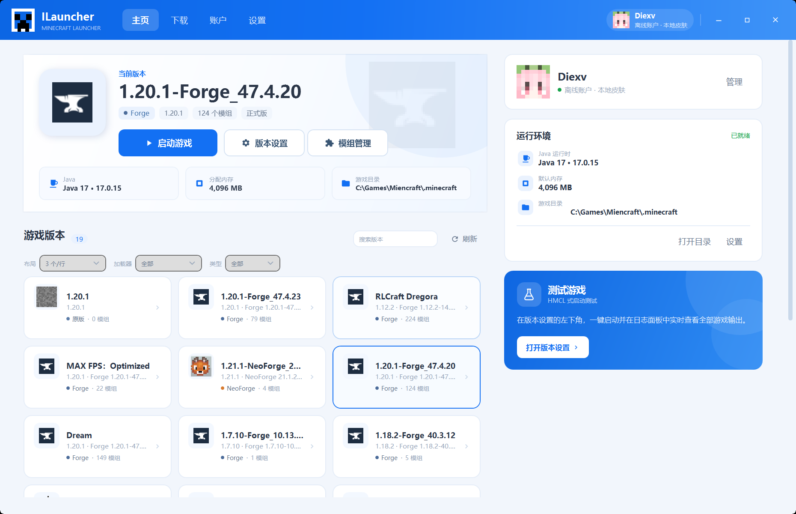

## 1.1 新增 / 补全的功能

| 模块 | 功能 |
| --- | --- |
| 皮肤 | 从本机客户端 jar 提取的 9 个 Mojang 默认皮肤、导入 64×64 皮肤、多图层（帽子/外套/袖子/裤子）渲染、Steve/Alex 模型切换、像素化 3D 旋转/缩放预览、披风显示、皮肤库、头像同步到标题栏和主页 |
| 正版登录 | 微软设备码登录（Xbox Live → XSTS → Minecraft Services），公开构建内置已提交审核的 Client ID；登录后可正版启动 |
| 正版皮肤 | 按玩家名或 UUID 查询 Mojang 档案，下载皮肤/披风并加入本地皮肤库 |
| 图标 | 版本本地 PNG 图标、整合包内图标；Fabric/Quilt/Forge/NeoForge/OptiFine 加载器徽标；模组 jar 内图标、资源包 `pack.png`、存档 `icon.png`、服务器图标 |
| 下载 | Mojang 官方版本列表（版本类型下拉筛选 + 版本号搜索）、原版安装、Fabric/Quilt、Forge/NeoForge 官方安装器、`.mrpack` 导入 |
| Modrinth | 搜索并安装模组/资源包/光影；可按当前/全部 MC 版本、加载器、类型/分辨率/风格筛选；模组更新检查与一键更新 |
| 资源管理 | 资源包/光影导入 ZIP、删除、打开；存档浏览、备份 ZIP、删除；截图浏览/打开/删除；服务器列表读取、添加、编辑、删除和自动连接 |
| 工具 | 导出启动脚本 `.bat`、导出实例 ZIP、崩溃日志诊断、Java 运行库下载（Adoptium 8/17/21） |
| 启动 | 离线账户、Java 自动选择、内存/窗口覆盖、版本隔离、测试日志面板、进程树停止 |

### 皮肤与头像

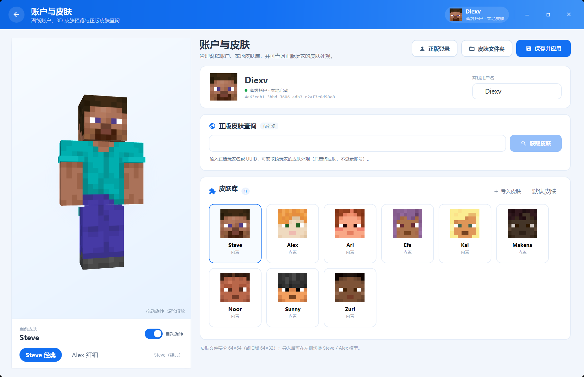

- **3D 皮肤预览**：直接用 WPF `Viewport3D` 拼出 Minecraft 的方块人体，拖动旋转、滚轮缩放、自动旋转。
- **多图层皮肤**：支持 64×64 皮肤的帽子层、外套层、左右袖子层、左右裤腿层；透明像素按 alpha 混合，外层几何略微外扩，避免与基础层 z-fighting。64×32 旧皮肤只显示基础层。
- **头像同步**：标题栏账户、主页账户卡、皮肤库头像都使用当前皮肤的头部（含帽子层）。
- **皮肤库**：启动时扫描本机 `.minecraft/versions/*/*.jar`，从客户端资源中提取 Mojang 默认 Steve / Alex / Ari / Efe / Kai / Makena / Noor / Sunny / Zuri；仓库不打包 Mojang 皮肤纹理。没有可用客户端时生成一个中性占位皮肤。
- **正版登录**：账户页右上角「正版登录」使用微软设备码流程。公开构建内置了已提交 Minecraft API 审核的 Azure Application (client) ID，玩家无需自己注册 Azure 应用；高级用户仍可通过「更换应用 ID」或 `MS_CLIENT_ID` 覆盖。登录后会走 Xbox Live、XSTS 和 Minecraft Services，刷新令牌使用 Windows DPAPI 加密保存在本机，启动时自动续期。
- **正版皮肤查询**：输入正版 ID 或 UUID，调用 Mojang 公开档案接口下载皮肤，不保存任何账号密码。
- 皮肤文件保存于 `%APPDATA%\ILauncher\skins\`，支持 64×64 与旧版 64×32。

#### 如何创建 Azure 应用 ID

如果 Azure 提示“在目录外部创建应用程序的功能已被弃用”，说明当前登录的 Microsoft 账户还没有可用的租户/目录。先创建目录，再注册应用：

1. 打开 [Azure 免费账户](https://azure.microsoft.com/free/)，用同一个 Microsoft 账户注册。免费账户会创建一个默认目录（例如 `xxx.onmicrosoft.com`）和 Azure 订阅；应用注册本身不收费，身份验证可能需要手机号和银行卡，但不会自动扣费。
2. 进入 [Azure Portal](https://portal.azure.com)，右上角账户菜单确认已切换到新目录。
3. 搜索 **Microsoft Entra ID** → **应用注册** → **新注册**。
4. 名称填 `ILauncher`；受支持的账户类型选 **“任何组织目录中的账户和个人 Microsoft 账户”**，或只登录个人 Minecraft 账户时选 **“个人 Microsoft 账户 / 所有 Microsoft 账户用户”** 也可以。不要选“仅此组织目录”或“仅组织目录”。
5. 注册后进入 **身份验证** → **高级设置** → 把 **“允许公共客户端流”** 设为 **“是”** 并保存。设备码流程不需要客户端密码，也不需要重定向 URI。
6. 在 **概述** 复制 **应用程序(客户端) ID**，粘贴到启动器「正版登录」窗口，点「保存并登录」。

> **重要：新 Azure 应用还需要通过 Minecraft Services 的应用注册审核。**
>
> 否则 OAuth、Xbox Live、XSTS 都可能成功，但最后 `login_with_xbox` 会返回：
>
> ```text
> HTTP 403 Invalid app registration
> ```
>
> 这是 Minecraft 对第三方启动器 Client ID 的白名单要求，不是“允许公共客户端流”没开。需要按 [Minecraft 官方说明](https://help.minecraft.net/hc/en-us/articles/16254801392141) 提交 Application (client) ID 审核；有社区反馈使用 [这个 Microsoft Forms 表单](https://forms.cloud.microsoft/Pages/ResponsePage.aspx?id=v4j5cvGGr0GRqy180BHbR-ajEQ1td1ROpz00KtS8Gd5UNVpPTkVLNFVROVQxNkdRMEtXVjNQQjdXVC4u) 提交后由 Mojang Enforcement 审核加入允许列表。审核不保证通过，也不能用别人的 Client ID 绕过。

#### 不绑卡的选择

如果不想绑定信用卡/借记卡，可以尝试以下路径：

#### 开发者：使用自己的 Client ID（可选）

公开构建默认使用 `SettingsService.BundledMicrosoftClientId`。开发和测试时可以用环境变量覆盖：

```powershell
$env:MS_CLIENT_ID = "你的 Azure Application (client) ID"
.\DiexvMinecraftLauncher.exe
```

或使用 `ILAUNCHER_MS_CLIENT_ID`。这个 ID 必须是你自己注册的 Azure 应用，不能使用 PCL2、HMCL 或其他项目的应用 ID。普通玩家不需要设置；发布版直接使用内置 Client ID。

> 修改内置 Client ID 后，需要重新提交 Minecraft API 的 AppID Review。


公开构建默认使用内置 Client ID；分发时不需要让玩家配置环境变量。修改内置 ID 后需要重新提交 Minecraft API 审核。


- **学生**：使用 [Azure for Students](https://azure.microsoft.com/free/students/)，通过学校邮箱/学生身份验证，通常不需要信用卡，会创建 Azure 订阅和默认目录。
- **已有工作/学校账户**：如果该账户所在组织有 Microsoft Entra 租户，直接在 [Entra 管理中心](https://entra.microsoft.com) 的应用注册里创建，不需要 Azure 订阅；如果看不到应用注册，需要管理员给你 Application Developer 权限。
- **有 Visual Studio 订阅**：在 [my.visualstudio.com/benefits](https://my.visualstudio.com/benefits) 激活 Azure 月度额度，按文档通常只做手机验证，不需要信用卡；激活时会创建 Azure 订阅/目录。
- **Microsoft 365 开发人员计划**：现在创建沙盒通常要求绑定计费账户/有效 Azure 订阅，**不再是可靠的免卡方案**，具体以 [官方 FAQ](https://learn.microsoft.com/office/developer-program/microsoft-365-developer-program-faq) 为准。

如果以上都不适用，就没有既安全又免卡的官方应用注册路径；可以继续使用离线账户，或让信任的、已有租户的管理员帮你注册一个“多租户 + 个人账户”的公共客户端应用，再把客户端 ID 给你。不要随便使用网上找来的第三方客户端 ID。

### 版本图标

- 在版本概览的「快捷操作 → 更换本地图标」中选择 PNG，图标保存到 `versions\<版本>\icon.png`，与 PCL 的版本本地图标兼容；「恢复默认图标」会删除它。
- 导入 `.mrpack` 时自动读取根目录 `icon.png`、`pack.png`，以及 `overrides/`、`client-overrides/` 中的 `icon.png`，复制为对应版本的本地图标。
- 主页版本列表支持按 **加载器（原版/Forge/Fabric/NeoForge/Quilt/OptiFine）**、**正式版/快照/旧版** 和版本名筛选；加载器和类型使用下拉菜单，筛选控件固定在同一行标题栏中，不会改变列表布局。数量会显示为“筛选结果 / 总数”。
- 版本列表布局只能手动切换：**列表 · 1 个/行**、**2 个/行**、**3 个/行**、**4 个/行**，选择会保存到设置，不会根据版本数量自动变化。
- 下载页版本图标按类型使用本机客户端 jar 内的官方纹理：**正式版草方块、快照/测试版命令方块、愚人节版土豆**；纹理提取到 `%APPDATA%\ILauncher\textures`，不打包官方纹理。
- 版本卡片、主页大卡、版本页侧栏、概览都会使用本地图标；未设置时按加载器自动使用 **Fabric / Quilt / Forge / NeoForge / OptiFine** 官方徽标，原版使用方块图标。徽标来源见 `Assets/Loaders/README.md`。
- 模组图标从 jar 内部读取（Fabric/Quilt/Forge/NeoForge 元数据），资源包读取 `pack.png`，存档读取 `icon.png`。

### 顶部导航

- 顶部固定显示 **主页 / 下载 / 账户 / 设置**；切换根界面不再依赖返回按钮，也不会在子页隐藏导航。
- 下载页使用四个大按钮切换 **游戏版本 / 模组 / 资源包 / 光影**，按钮位于页面标题下方，不再使用小标签或右上角下拉。
- 版本页保留原有左侧导航栏；**概览 / 设置 / 模组管理 / 资源包 / 光影 / 存档 / 截图 / 服务器** 仍在侧栏切换，模组列表、资源包、存档等功能保持原布局。
- 顶部只负责根界面（主页/下载/账户/设置）切换；版本页的“测试游戏”按钮仍在左侧栏左下角。

### 下载中心

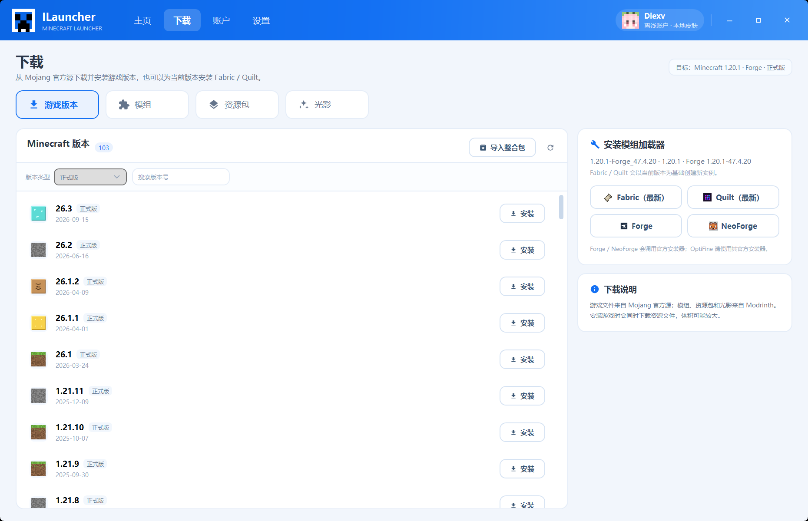

- **游戏版本**：左侧是 Mojang 版本列表，默认 **正式版**，可按 **全部 / 正式版 / 快照 / 旧版** 筛选，也可按版本号搜索；左侧不再放安装按钮。选中版本后，右侧选择加载器和加载器版本，最后点击右侧底部「安装」。
- **加载器**：右侧可切换原版 / Fabric / Quilt / Forge / NeoForge，并列出该 Minecraft 版本可用的加载器版本；原版或加载器所需的原版客户端缺失时会先自动安装。Fabric / Quilt 走 Meta API；Forge / NeoForge 调用官方安装器 jar（需要 Java 与网络），缺少 `launcher_profiles.json` 时自动补最小档案文件。
- **整合包**：支持 Modrinth `.mrpack` 导入，读取依赖中的 Minecraft/加载器版本，安装加载器、下载文件并复制 `overrides`；同时读取包内 `icon.png`/`pack.png` 作为版本本地图标。
- **Modrinth 内容**：模组、资源包、光影搜索与安装。筛选使用带标题的下拉菜单：**版本范围**（当前/全部）、**加载器**（当前/全部/Fabric/Forge/NeoForge/Quilt）、**类型**（优化/科技/魔法/冒险/装饰/辅助/前置库；资源包按 16×/32×/64×/128×/256×；光影按写实/奇幻/卡通/半写实/原版风）。每页 20 个结果，底部提供上一页/下一页和总页数。结果附带 **MC百科** 中文名与链接，以及 **CurseForge** 搜索链接。
- **MC百科**：通过公开搜索页匹配模组中文名与条目链接；即使没有中文名，只要匹配到条目也会显示 MC百科链接。结果缓存到设置目录。每项结果也附带 **CurseForge** 搜索链接。
- **CurseForge**：当前提供的是按项目标题搜索的网页链接，不是 CurseForge API 安装源；正式接入需要 CurseForge API Key。
- **进度与取消**：下载面板实时显示阶段、文件名、百分比，支持取消。

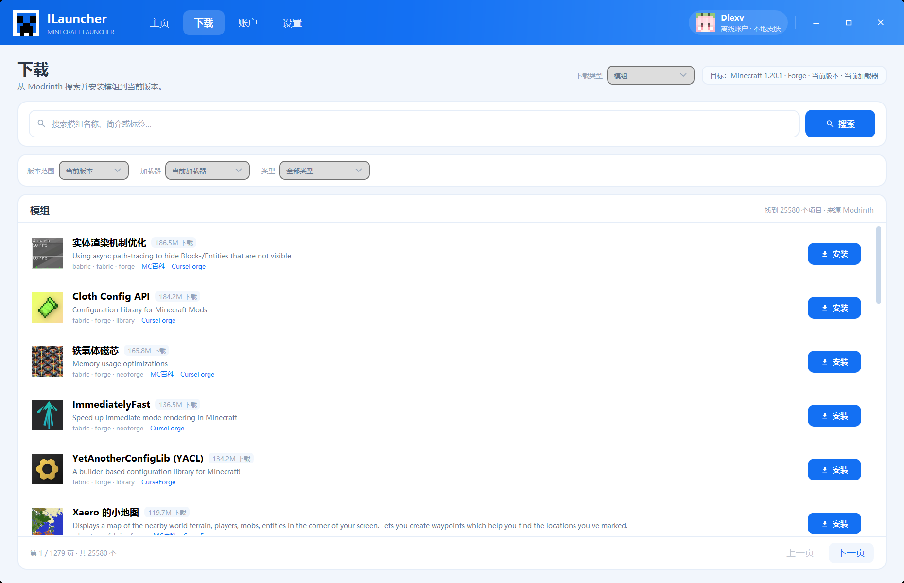

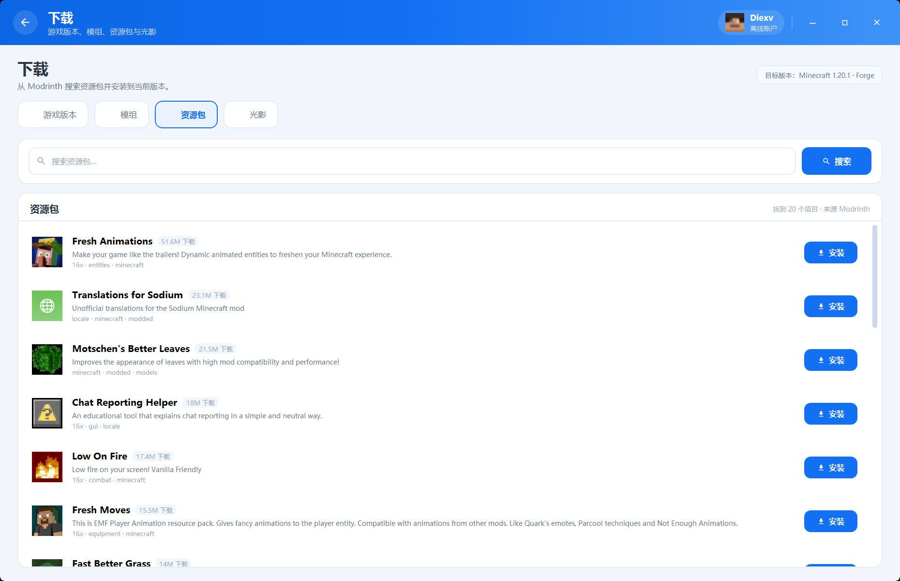

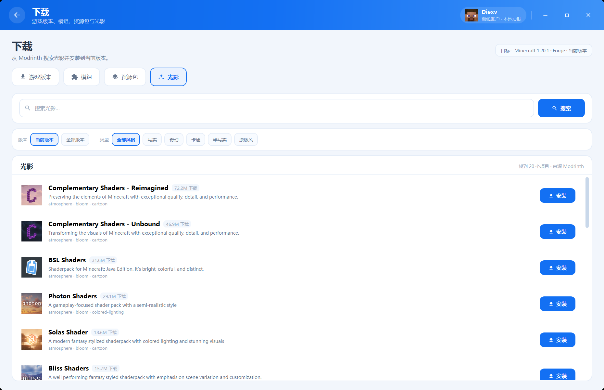

### 资源管理

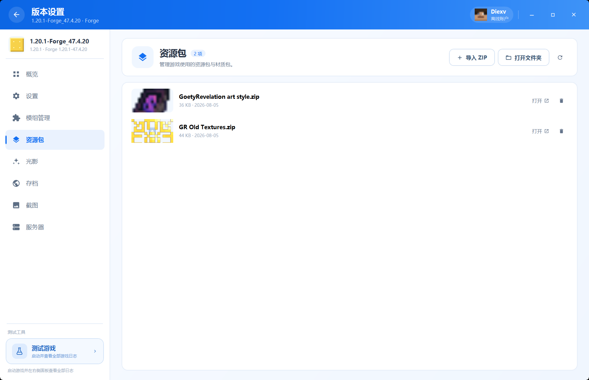

- 资源包/光影：导入 ZIP、打开、删除；自动提取 `pack.png` 作为图标。
- 存档：显示 `icon.png`，支持备份为 ZIP（`%APPDATA%\ILauncher\backups\saves`）与删除。
- 截图：真实缩略图，可打开默认看图程序或删除。
- 服务器：读取/写入 `servers.dat`（NBT），显示名称/IP/图标，支持添加、编辑、删除，点击「加入」启动游戏并传入 `--server` / `--port`。

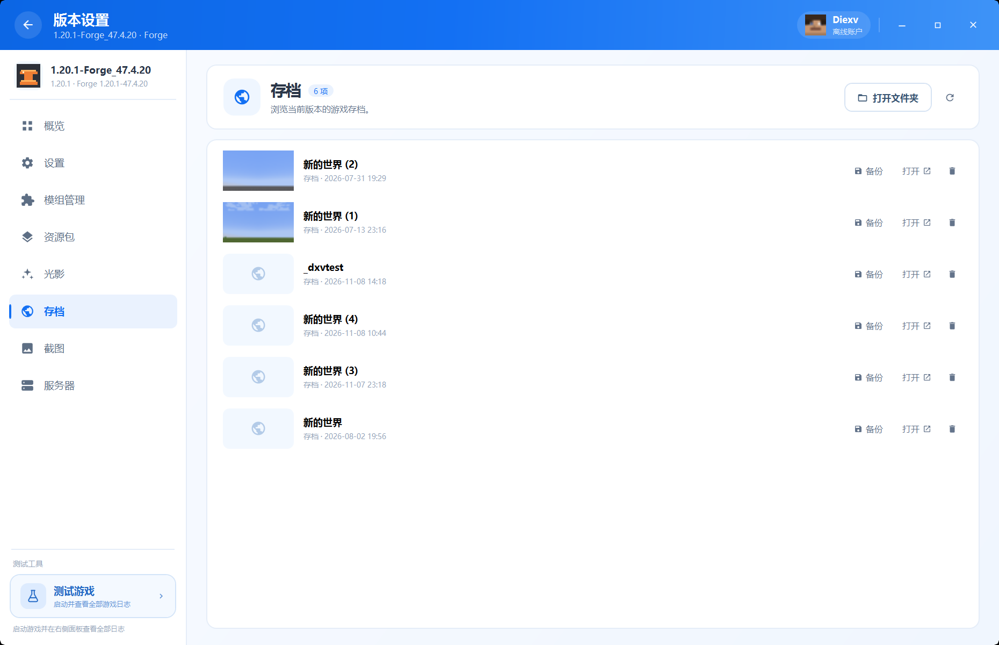

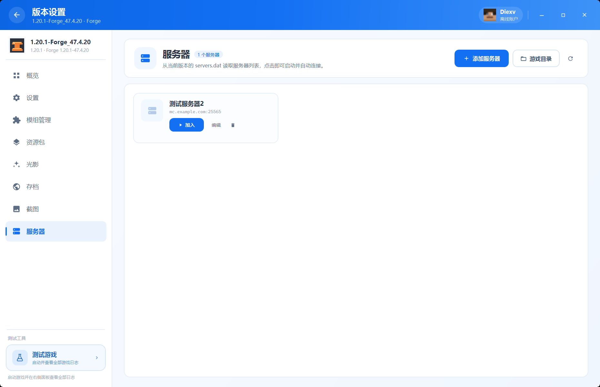

### 模组管理

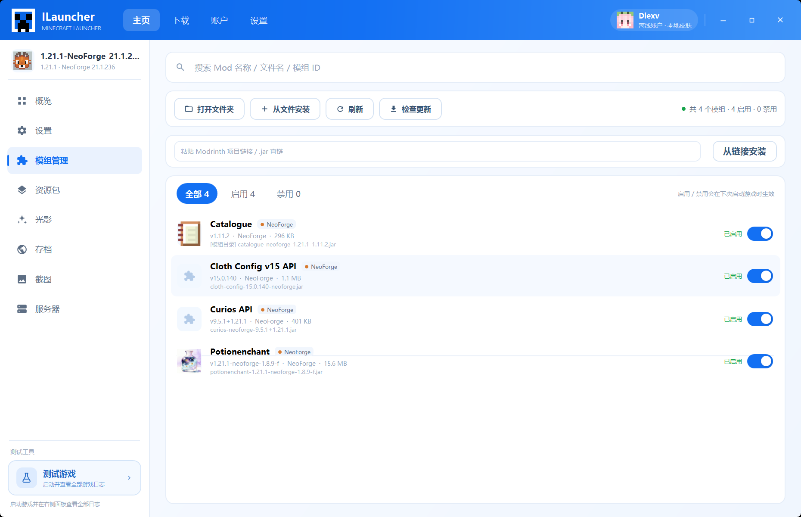

- 读取 `mods/*.jar` 与 `*.jar.disabled`，当前实测 124 个模组、2 个启用。
- 从 `fabric.mod.json`、`quilt.mod.json`、`META-INF/mods.toml`、`MANIFEST.MF` 读取显示名、版本、模组 ID 和图标。
- 启用/禁用通过重命名 `.jar` ↔ `.jar.disabled` 完成，下次启动生效。
- 搜索、全部/启用/禁用筛选、从文件安装、从链接安装、打开目录、刷新。
- 模组下载页有两个游戏版本选择：**游戏版本**用于选择安装目标（本机已安装版本），**搜索版本**用于按任意正式版筛选 Modrinth；支持按相关度、下载量、最近更新和最新发布排序。
- 新增「整合包」在线搜索页，可直接选择版本并安装 Modrinth 整合包；新增项目「详情」窗口，查看介绍、截图和链接。
- 搜索结果列表不再有安装按钮；直接点击模组行会弹出安装界面。安装界面顶部可选择下载版本（默认当前搜索筛选的版本）、模组加载器和发布通道（全部/正式版/Beta/Alpha），下方选择具体文件版本后安装。
- 安装界面会显示所选文件在 Modrinth 上声明的全部前置模组（必需/可选），递归检查前置的前置，并检测目标实例是否已安装必需前置；缺少时提供「一键安装缺失前置」。
- 前置扫描依据 Modrinth 版本元数据；作者未在 Modrinth 声明的隐式依赖无法提前发现，解析失败的前置会单独提示。
- 中文搜索：输入中文模组名时先用 MC百科解析英文别名（如“钠”→“Sodium”），再搜索 Modrinth；无法解析时保留原查询。\n- 前置检测同时读取 Modrinth 依赖和 JAR 元数据（mods.toml / fabric.mod.json），只通过 HTTP Range 读取 ZIP 元数据，不下载完整 JAR；结果写入 `jar-dependencies.json` 缓存。
- **从链接安装**：粘贴 Modrinth 项目链接会自动解析并下载当前版本兼容文件；也支持 `.jar` 直链。CurseForge 项目页仍需要 API Key，建议浏览器下载后使用「从文件安装」。
- 「检查更新」通过 Modrinth 的 SHA-1 文件查询找到项目，再按当前 MC 版本/加载器找最新版本；行内「更新」下载新文件并禁用旧文件。

### 独立「测试游戏」按钮（HMCL 式）

按钮固定在版本设置左侧栏左下角，位于导航列表下方的「测试工具」区域；不在导航列表中，也不会改变根界面的顶部导航。点击后：

1. 右侧内容切换到「测试游戏 · 启动日志」；
2. 按当前版本配置启动 Java 进程；
3. 日志面板实时显示启动阶段、游戏进程 stdout/stderr、退出码和日志文件路径；
4. 支持按级别过滤、搜索、自动滚动、复制、打开日志文件/文件夹、停止与重新测试；
5. 启动失败时自动运行基础崩溃诊断，把建议写入日志。

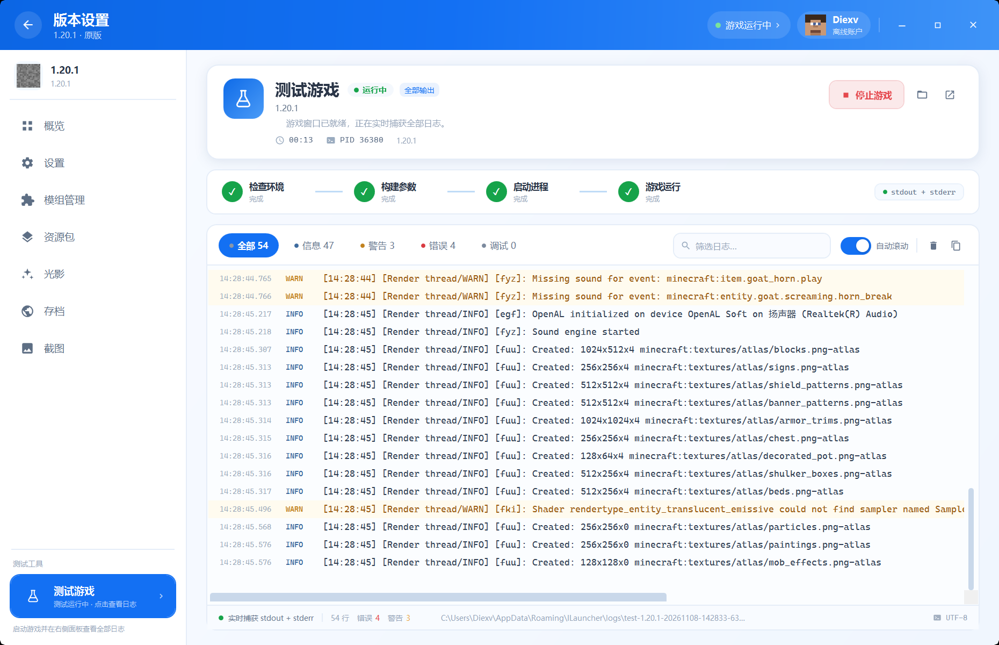

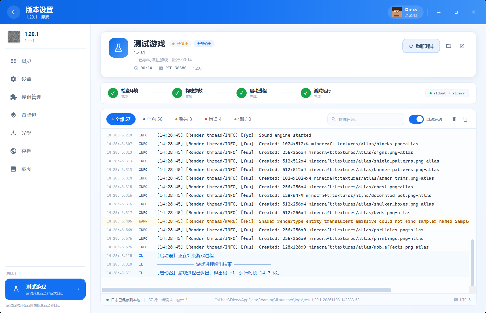

### 版本概览与工具

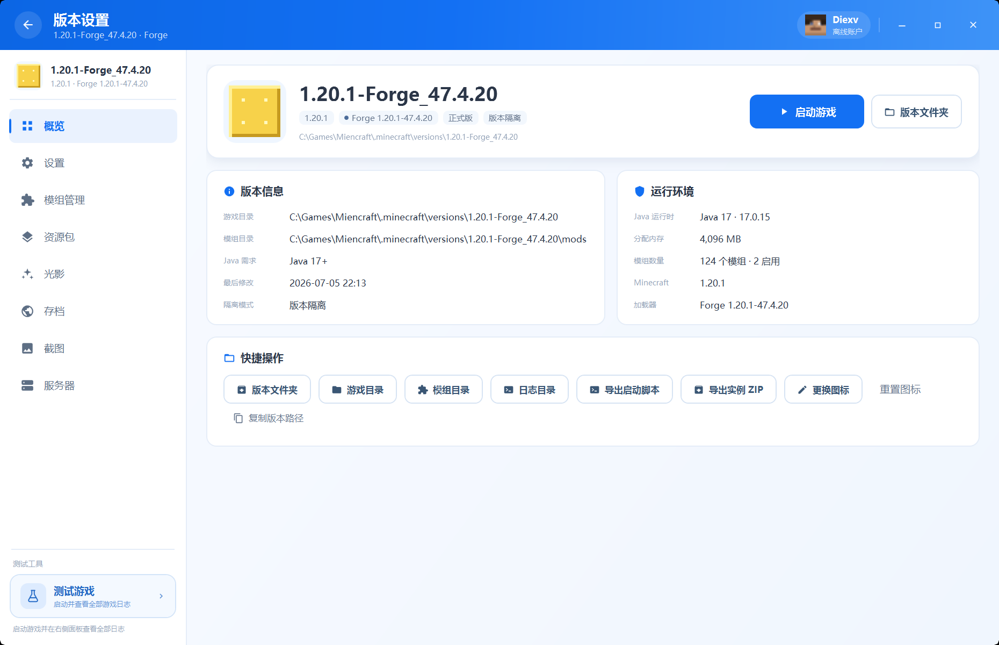

- 版本信息、Java/内存、路径、隔离模式。
- 打开版本/游戏/模组/日志目录。
- 导出启动脚本（使用真实解析出的 Java 路径、ClassPath、JVM/游戏参数）。
- 导出实例 ZIP（排除 logs、crash-reports、screenshots、natives、缓存，附带实例元数据）。
- 更换/重置版本图标。

### 启动器设置

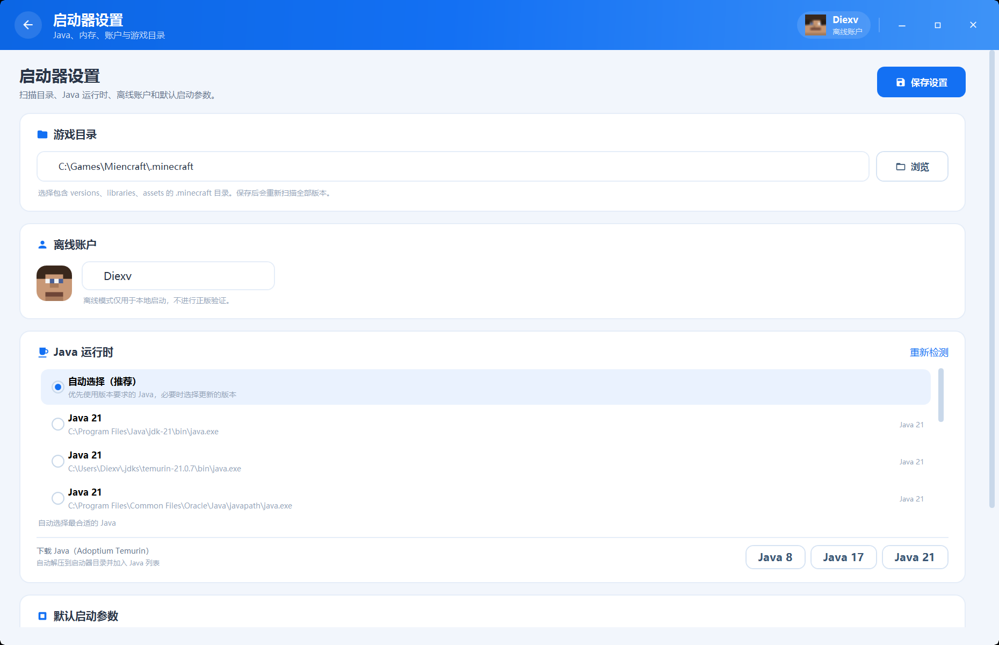

- Minecraft 目录、离线用户名、Java 选择、下载源、默认内存、游戏窗口大小、启动后最小化。
- Java 运行时列表、重新检测、Adoptium Java 8/17/21 下载；Java 列表支持直接点击切换。
- 游戏文件下载源支持 **官方源优先 / 镜像源优先（BMCLAPI）** 切换，镜像失败时回退官方源。
- 设置保存到 `%APPDATA%\ILauncher\settings.json`。

## 源码研究

本项目只参考了两个开源项目的**界面结构与交互思路**，没有复制其代码或图片资源。关键参考位置：

### PCL2 社区版

- 仓库：[PCL-Community/PCL2-CE](https://github.com/PCL-Community/PCL2-CE)（默认分支 `dev`）
- `Plain Craft Launcher 2/FormMain.xaml`：无边框窗口、WindowChrome、标题栏结构。
- `Plain Craft Launcher 2/Pages/PageInstance/PageInstanceLeft.xaml`：版本设置左侧导航，使用 `MyListItem` 单选列表。
- `Plain Craft Launcher 2/Controls/MyListItem.xaml`：导航项图标、标题、选中态。
- `Plain Craft Launcher 2/Application.xaml`：主题色（`#343D4A` 文本、`#1370F3` 主色、`#FBFBFB` 背景）与字体。
- PCL2 的版本管理页也有「测试游戏」入口（概览 → 管理），本项目按需求把它放在版本设置左侧栏左下角并做成独立按钮。

### HMCL

- 仓库：[HMCL-dev/HMCL](https://github.com/HMCL-dev/HMCL)
- `.../ui/instances/GameInstancePage.java`：版本页导航抽屉中的 `instance.launch.test` 菜单项与 `testGame()`。
- `.../game/LauncherHelper.java`：`setTestMode()` 将 `launcherVisibility` 设为 `KEEP`、`showLogs` 设为 `true`。
- `.../ui/instances/Instances.java`：`testGame()` → `launch(gameInstance, LauncherHelper::setTestMode)`。
- `.../ui/LogWindow.java`：日志级别筛选、自动滚动、导出。
- 语言文件 `I18N_zh_Hans.properties`：`instance.launch.test=测试游戏`。

## 构建 / 运行

环境：Windows 10/11 x64、[.NET 8 SDK](https://dotnet.microsoft.com/)（运行 Release 版本需要 .NET 8 Desktop Runtime）、对应版本的 Java。

```powershell
dotnet build ILauncher.sln -c Release

dotnet publish src/ILauncher/ILauncher.csproj -c Release -r win-x64 `
  --self-contained false -o dist/DiexvMinecraftLauncher
```

运行：

```powershell
.\dist\DiexvMinecraftLauncher\DiexvMinecraftLauncher.exe
```

也可以 `dotnet run --project src/ILauncher/ILauncher.csproj`。

## 使用

1. 首次启动自动寻找 `%APPDATA%\.minecraft`、`C:\Games\Miencraft\.minecraft` 等目录；也可在设置中选择。
2. 主页选择版本 → 「启动游戏」直接启动；「版本设置」进入版本页。
3. 版本页左下角「测试游戏」→ 打开启动日志面板。
4. 下载页安装游戏/加载器/模组/资源包/光影，或导入 `.mrpack` 整合包。
5. 账户页导入皮肤、切换 Steve/Alex、查询正版皮肤，保存后标题栏/主页头像同步。
6. 模组页可检查更新、启停、搜索、安装。

### 数据位置

| 内容 | 路径 |
| --- | --- |
| 设置 | `%APPDATA%\ILauncher\settings.json` |
| 启动日志 | `%APPDATA%\ILauncher\logs\` |
| 皮肤库 | `%APPDATA%\ILauncher\skins\` |
| 版本图标 | `versions\<版本>\icon.png`（旧版 `%APPDATA%\ILauncher\icons\` 仍可读取） |
| 版本列表纹理 | `%APPDATA%\ILauncher\textures\`（从本机客户端 jar 提取） |
| 原生库缓存 | `%APPDATA%\ILauncher\cache\natives\` |
| MC百科匹配缓存 | `%APPDATA%\ILauncher\mcmod-cache-v2.json` |
| 下载的 Java | `%APPDATA%\ILauncher\java\` |
| 存档备份 | `%APPDATA%\ILauncher\backups\saves\` |

## 项目结构

```
ILauncher.sln
src/ILauncher.Core/          启动引擎、版本解析、Java、模组、下载、日志、皮肤查询
src/ILauncher/               WPF 界面（MVVM）
  Themes/                    PCL2 风格颜色、图标、控件样式
  Views/                     主页、账户/皮肤、下载、版本页、模组、日志、设置
  ViewModels/                导航、皮肤、下载、模组、日志、服务器、设置
  Controls/                  Icon、SkinHead、SkinPreview、3D 皮肤模型
  Assets/                    像素方块、原创皮肤、应用图标
tools/Probe/                 控制台启动探针
tools/                       UI 截图/资源生成辅助脚本
docs/screenshots/            README 截图
```

## 已验证

- Forge 1.20.1（124 模组、2 启用）：真实启动，日志面板捕获 7,000+ 行，窗口检测、停止进程树。
- 原版 1.20.1：启动、停止、日志面板。
- Fabric 安装：通过 Meta API 创建 `fabric-loader-0.20.1-1.20.1`（测试后清理）。
- Modrinth：搜索、下载类型大按钮、加载器/版本范围/类型筛选、翻页、MC百科中文名、安装资源包到版本目录（测试后清理）。
- 原版 1.20.1 安装器：临时目录下载版本 JSON、客户端 jar 和 65 个库文件（不下载资源对象）。
- Forge 官方安装器：在全新临时目录完整安装 `1.20.1-forge-47.4.21`，自动生成 `launcher_profiles.json` 并完成打补丁。
- 模组更新：放入旧版 Cloth Config 后检查到 11.1.136，点击更新后旧文件被禁用、新文件启用（测试后清理）。
- 皮肤：运行时从本机客户端 jar 提取 9 个 Mojang 默认皮肤、Steve/Alex 与 slim/wide 模型映射、64×64 多图层（帽子/外套/袖子/裤子）渲染、像素化 3D 预览、像素头像、Mojang 皮肤查询、保存后头像同步。
- 模组启停通过真实重命名完成并恢复。
- 服务器：`servers.dat` NBT 读写往返、界面添加/编辑/删除、刷新后重新读取。
- 资源包：ZIP 导入、`pack.png` 图标提取、删除。
- 存档：真实存档备份为 ZIP。
- 导出：生成真实 Java/ClassPath/游戏参数的 `.bat`；实例 ZIP 排除日志/截图。
- 崩溃分析：OutOfMemory、Java 版本过低、Mixin 失败等规则命中。
- Java：Adoptium API 解析（Java 21 包信息）；下载流程实现并显示字节进度，测试环境下载较慢。
- 微软登录：设备码请求、浏览器跳转、错误提示已验证；完整登录仍受 Minecraft Services 白名单限制（见上方 403 说明）。
- Release 发布版启动验证。

## 已知限制（与 PCL2 相比仍缺少的部分）

- **微软登录依赖内置 Client ID 通过 Minecraft Services 审核**：审核通过前 `login_with_xbox` 会返回 403；访问令牌与刷新令牌使用 Windows DPAPI 加密保存在本地，过期后自动续期。
- **没有实现 OptiFine / LiteLoader 自动安装**：仍需使用它们的官方安装器。
- **CurseForge 未接入**：内容下载使用 Modrinth；整合包只支持 Modrinth `.mrpack`。
- 没有资源包加载顺序编辑、世界/数据包在线下载。
- 模组安装不会自动解析并安装前置依赖；只安装主文件。
- Forge/NeoForge 走官方安装器，不保证所有版本都能在无界面模式下成功。
- 启动器自身更新与主题切换尚未实现（界面语言已支持中文/英文切换）。


